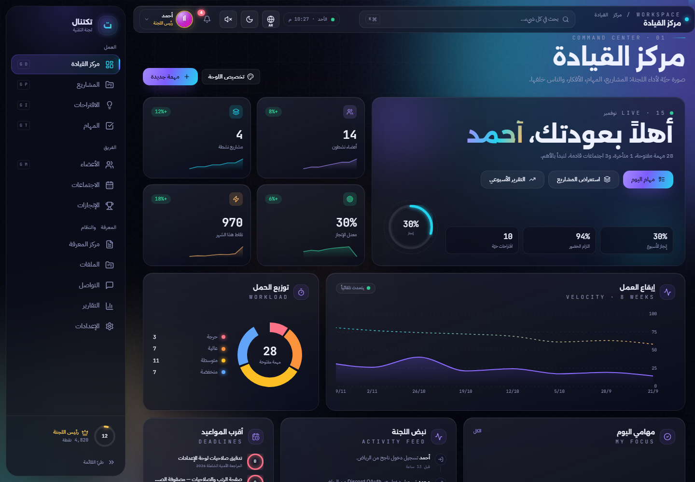
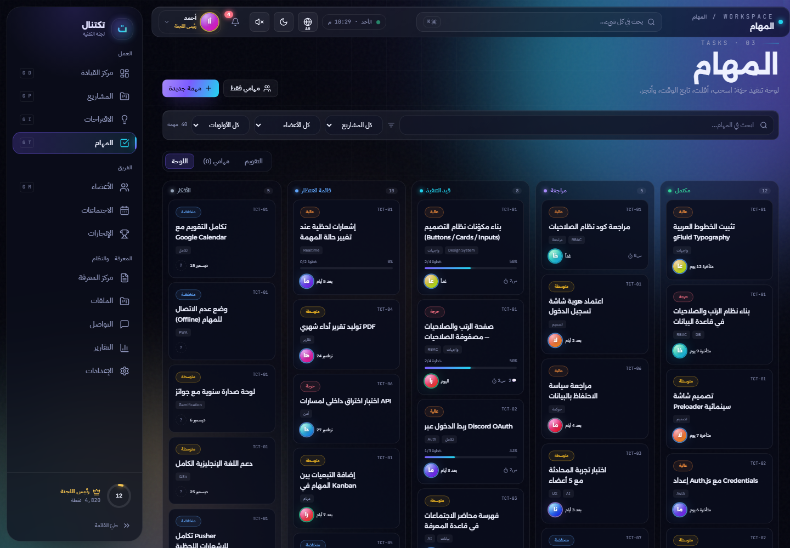

# تكتنال · TECTNAL

> نظام إدارة متكامل للجان التقنية — واجهة عربية RTL بهوية بصرية مستقبلية، ورتب ديناميكية، ومشاريع ومهام واقتراحات وإنجازات في مساحة عمل واحدة.






---

## ١. ما هذا؟

**تكتنال** منصة داخلية جاهزة للاستخدام الفعلي (وليس نموذجاً تجريبياً) لإدارة لجنة تقنية:

| القسم | ما يقدمه |
| --- | --- |
| **مركز القيادة** | ودجات Bento قابلة لإعادة الترتيب، أرقام متحركة، مخططات لحظية، مهام اليوم، نبض الفريق، الصدارة |
| **المشاريع** | عرض شبكة / كانبان / جدول زمني / قائمة، معالم، فريق، ميزانية، مهام مرتبطة، نقاش |
| **الاقتراحات** | تصويت إيجابي/سلبي، نقاط أولوية محسوبة، مسار حالات، تحويل بنقرة إلى مشروع، نقاش متداخل، لوحة مقترحين |
| **المهام** | Kanban بسحب وإفلات، مهام فرعية، تبعيات، مؤقّت وقت، تكرار، تقويم، لوحة "مهامي" |
| **الأعضاء** | بطاقات هولوغرافية، ملف كامل، شارات، هيكل تنظيمي، دعوات بكود |
| **الاجتماعات** | تقويم، جدول أعمال، حضور بأربع حالات، محضر قابل للتحرير |
| **الإنجازات** | صدارة شهرية/سنوية، مستويات، شارات نادرة، احتفال Confetti |
| **مركز المعرفة** | مقالات بمحتوى منسّق، تصنيفات، بحث، مقالات ذات صلة |
| **الملفات** | مجلدات، أنواع، أحجام، معاينة، صلاحيات لكل ملف (نموذج) |
| **التواصل** | إعلانات مثبّتة، قنوات دردشة (إرسال فعلي)، مركز إشعارات |
| **التقارير** | أداء الأعضاء، قمع الاقتراحات، الميزانية، الحضور، تصدير CSV وطباعة |
| **الإعدادات** | مصفوفة صلاحيات كاملة، إنشاء رتب، تغيير رتب الأعضاء، الهوية، سجل التدقيق، منطقة خطر |
| **Command Palette** | `Ctrl/Cmd + K` — بحث موحّد في كل الكيانات + أوامر سريعة |

---

## ٢. إعداد مسؤول النظام

لا توجد حسابات أو سجلات جاهزة. عند التشغيل لأول مرة يفتح النظام صفحة إعداد المسؤول الرئيسي؛ أدخل الاسم والبريد وكلمة مرور لا تقل عن 12 حرفاً. يُنشأ حساب واحد برتبة رئيس اللجنة وصلاحيات إدارة النظام، ثم ينتقل التطبيق إلى تسجيل الدخول. لا توجد كلمة مرور مشتركة أو حسابات تجريبية.

---

## ٣. التشغيل

```bash
npm install          # تثبيت الحزم
npm run dev          # http://localhost:3000
```

يبدأ المشروع بمساحة عمل نظيفة عبر طبقة بيانات محلية (`.data/tectnal.json`). لا تُنشأ مشاريع أو مهام أو حسابات تلقائياً؛ البيانات التي يضيفها المسؤول تُحفظ بين الجلسات. عند ترقية مخزن الإصدار السابق، تزال بيانات العرض القديمة مرة واحدة ثم يظهر إعداد المسؤول الرئيسي.

```bash
npm run build        # بناء إنتاجي
npm run start        # تشغيل نسخة الإنتاج
npm run typecheck    # فحص TypeScript Strict
npm run fonts        # نسخ الخطوط إلى public/fonts
```

### تطبيق سطح المكتب على Windows

يعمل التطبيق كبرنامج Windows مستقل باستخدام Electron، ويشغّل نسخة Next.js محلية داخل نافذته. بيانات كل مستخدم تُحفظ في مجلد بيانات التطبيق داخل حساب Windows ولا تُكتب داخل مجلد التثبيت.

```bash
npm install
npm run desktop:dev   # تشغيل نسخة سطح المكتب أثناء التطوير
npm run build:desktop # إنشاء مثبّت Windows في release/
```

بعد إنشاء المثبّت، شغّل `release/TECTNAL-1.1.0-Setup.exe`. بيانات التطبيق ومفتاح الجلسات المحلي يبقيان محفوظين في مجلد بيانات TECTNAL للمستخدم. لا يحتاج تطبيق سطح المكتب إلى Neon أو اتصال خارجي بقاعدة بيانات.

### أوامر قاعدة البيانات (PostgreSQL)

```bash
npm run db:generate  # توليد Prisma Client
npm run db:push      # إنشاء الجداول
npm run db:seed      # تصفير الجداول وإنشاء مساحة عمل فارغة
npm run db:studio    # Prisma Studio
```

---

## ٤. البنية

```
src/
├─ app/
│  ├─ (workspace)/            # كل صفحات النظام المحمية
│  │  ├─ dashboard/           # مركز القيادة
│  │  ├─ projects/[id]/       # المشاريع + تفاصيل المشروع
│  │  ├─ proposals/ tasks/ members/[id]/
│  │  ├─ meetings/ achievements/ knowledge/[slug]/
│  │  ├─ files/ comms/ reports/ settings/
│  │  ├─ layout.tsx           # AppShell + حماية الجلسة
│  │  └─ loading.tsx          # Skeleton مطابق للمحتوى
│  ├─ sign-in/                # شاشة دخول سينمائية
│  ├─ api/auth/[...nextauth]/ # Auth.js v5
│  ├─ error.tsx not-found.tsx forbidden/
│  ├─ layout.tsx globals.css
├─ components/
│  ├─ ui/                     # Button, Card, Badge, Avatar, Dialog, Tabs…
│  ├─ fx/                     # Aurora, Preloader, Cursor, Spotlight, Reveal, CountUp…
│  ├─ shell/                  # Sidebar (Dock), Topbar, CommandPalette, AppShell
│  ├─ dashboard/ projects/ tasks/ proposals/ members/ meetings/ …
│  └─ providers.tsx           # Session + Query + Theme + i18n + Toaster
├─ hooks/                     # ٢٠ Hook موثّقاً
├─ lib/                       # permissions, types, utils, i18n, navigation, icons
├─ server/
│  ├─ actions.ts              # ٣٠+ Server Action محمي بـ Zod + RBAC + Audit
│  ├─ repository.ts           # طبقة قراءة تُنتج View Models
│  ├─ guard.ts                # requireSession / requirePermission / assertPermission
│  ├─ db.ts                   # مخزن JSON محلي مع كتابة متسلسلة وترقية الحالة
│  └─ data/                   # الرتب والإعدادات الافتراضية، دون حسابات أو سجلات جاهزة
├─ auth.ts                    # NextAuth v5 (Credentials + Discord)
├─ middleware.ts              # خط الدفاع الأول
prisma/
├─ schema.prisma              # ٢٥+ جدولاً، Enums، Indexes، Soft Delete
└─ seed.ts                    # تهيئة PostgreSQL بمساحة عمل فارغة
```

---

## ٥. المراحل المسلّمة

| المرحلة | الحالة | أين |
| --- | --- | --- |
| ١ — الهيكل والإعداد | ✅ | `package.json`, `next.config.ts`, `tsconfig.json`, `.env.example` |
| ٢ — Prisma + Seed + الصلاحيات | ✅ | `prisma/schema.prisma`, `prisma/seed.ts`, `src/lib/permissions.ts` |
| ٣ — نظام التصميم + الـ Hooks | ✅ | `src/app/globals.css`, `src/components/ui`, `src/components/fx`, `src/hooks` |
| ٤ — المصادقة + Layout + Palette | ✅ | `src/auth.ts`, `src/middleware.ts`, `src/components/shell` |
| ٥ — لوحة القيادة | ✅ | `src/components/dashboard` |
| ٦ — المشاريع | ✅ | `src/components/projects` |
| ٧ — الاقتراحات | ✅ | `src/components/proposals` |
| ٨ — المهام | ✅ | `src/components/tasks` |
| ٩ — الأعضاء + الاجتماعات + الإنجازات | ✅ | `members/`, `meetings/`, `achievements/` |
| ١٠ — باقي الأقسام + الإشعارات | ✅ | `knowledge/ files/ comms/ reports/ settings/` |
| ١١ — التحسين والنشر | ✅ | دليل النشر أدناه، Typecheck، بناء إنتاجي، Skeletons، Error Boundaries |

---

## ٦. هوية التصميم

**Futuristic Arabic Cyber-Elegance** — خلفية شبه سوداء، أورورا متحركة هادئة، شبكة خافتة، وطبقات Glass مع حدود متدرجة وحبيبات (Noise).

- **الخطوط**: Alexandria (عناوين) + IBM Plex Sans Arabic (نصوص) + JetBrains Mono (أرقام/كود) + Vazirmatn (أرقام عربية) — كلها **مستضافة محلياً** في `public/fonts` مع `font-display: swap` ولا طلب واحد إلى Google.
- **الألوان**: بنفسجي `#7C5CFF` → سماوي `#22D3EE`، تمييز دافئ `#FFB86B`، وألوان دلالية، مع ثيم فاتح كامل عبر `next-themes`.
- **RTL أصيل**: خصائص منطقية (`inset-inline-start`, `padding-inline`) وتخطيط ينعكس تلقائياً.
- **التفاعلات**: Spotlight يتبع المؤشر، Tilt 3D خفيف، Magnetic Buttons، Shimmer، عدّادات، Preloader سينمائي، سحب ودجتس، احترام كامل لـ `prefers-reduced-motion`.

---

## ٧. الرتب والصلاحيات (RBAC)

- ٧ رتب افتراضية: رئيس اللجنة (100) ← نائب (90) ← مدير قسم (70) ← قائد مشروع (55) ← عضو أساسي (40) ← متدرب (20) ← ضيف (10).
- **٤٦ صلاحية دقيقة** بمفاتيح مثل `projects.create`, `tasks.assign`, `members.rank.edit`, `system.danger`.
- مصفوفة صلاحيات تفاعلية في `/settings` مع حفظ فوري وسجل تدقيق لكل تغيير.
- **حماية ثلاثية**: Middleware → فحص على الخادم في كل صفحة وكل Server Action → إخفاء عناصر الواجهة عبر `usePermission` / `hasPermission`.
- الرتب بيانات لا كود: إنشاء رتبة جديدة، تعديل ألوانها ومستواها وصلاحياتها، وترقية/تخفيض الأعضاء — كلها من الواجهة.

---

## ٨. الـ Hooks (٢٠)

جميعها في `src/hooks` ومصدّرة من `@/hooks`.

| Hook | مثال |
| --- | --- |
| `useSpotlight` | `const ref = useSpotlight<HTMLDivElement>(); <div ref={ref} className="spotlight glass" />` |
| `useMagnetic` | `const ref = useMagnetic<HTMLButtonElement>(0.25); <button ref={ref}>ابدأ</button>` |
| `useTilt3D` | `const ref = useTilt3D<HTMLDivElement>(6); <div ref={ref} className="glass" />` |
| `useCountUp` | `const value = useCountUp(1284, { duration: 1400 });` |
| `useScrollProgress` | `const p = useScrollProgress(); style={{ transform: \`scaleX(${p})\` }}` |
| `useCommandPalette` | `const { open, toggle } = useCommandPalette();` |
| `useHotkeys` | `useHotkeys({ "mod+k": toggle, "g d": () => router.push("/dashboard") });` |
| `usePermission` | `const { can } = usePermission(); can("projects.create")` |
| `useOptimisticMutation` | `useOptimisticMutation({ mutationFn: castVote, queryKey: ["proposals"], optimisticUpdate })` |
| `useRealtime` | `useRealtime(() => router.refresh(), { intervalMs: 20000 })` |
| `useInfiniteList` | `const { visible, hasMore, loadMore } = useInfiniteList(items, 12);` |
| `useDebouncedSearch` | `const { query, setQuery, debounced } = useDebouncedSearch(220);` |
| `useLocalDraft` | `const draft = useLocalDraft("proposal-draft", { title: "" });` |
| `useIdleDetector` | `const { idle } = useIdleDetector(60_000);` |
| `useViewTransition` | `const transition = useViewTransition(); transition(() => setView("kanban"));` |
| `useMediaQuery` | `const isDesktop = useMediaQuery("(min-width: 1024px)");` |
| `useClipboard` | `const { copy, copied } = useClipboard(); copy(inviteLink);` |
| `useUndoRedo` | `const { value, set, undo, redo, canUndo } = useUndoRedo(initial);` |
| `useConfetti` | `const { fire } = useConfetti(); fire({ count: 120 });` |
| `useSoundFx` | `const { play, enabled, toggle } = useSoundFx(); play("success");` |
| `useTimeTracker` | `const timer = useTimeTracker(task.id); timer.start(); timer.stop();` |

---

## ٩. الأمان والجودة

- **Zod على كل مُدخل** + رسائل خطأ عربية، و`rate limiting` داخلي لكل إجراء حسّاس.
- كلمات المرور بـ **bcrypt**، جلسات JWT قصيرة (٨ ساعات)، وAuth.js يدير CSRF تلقائياً.
- كل Server Action يبدأ بـ `assertPermission(...)`، ثم يتحقق من صحة البيانات، ثم يسجّل في `AuditLog`.
- حماية XSS: لا `dangerouslySetInnerHTML` إلا لمحتوى مقالات داخلي موثوق.
- **Accessibility**: تسميات `aria`، تركيز مرئي قوي، دعم لوحة المفاتيح للسحب والـ Palette، تباين AA.
- **Error Boundaries** + صفحات 404/403/500 مصممة، وSkeleton Loaders لكل مسار.
- Responsive كامل: جوال (شريط سفلي + Drawer)، تابلت، ديسكتوب (Sidebar عائم قابل للطي).

---

## ١٠. تخزين Neon

يعمل التطبيق محلياً على ملف JSON داخل `.data`. للتخزين الدائم على Neon، عيّن `DATABASE_PROVIDER=neon` و`DATABASE_URL` إلى رابط PostgreSQL، ثم نفّذ `npm run db:push`. يحفظ التطبيق حالة مساحة العمل في سجل JSONB داخل جدول `Setting` ويقفل السجل أثناء التعديلات حتى تبقى الكتابات متسقة بين وظائف Vercel.

يحتوي `prisma/schema.prisma` أيضاً على المخطط العلائقي الكامل للكيانات. التخزين الحالي على Neon يحافظ على واجهة البيانات الحالية دون تحويل كل إجراء إلى استعلام مستقل؛ يمكن ترحيل الكيانات إلى الجداول العلائقية تدريجياً عند الحاجة للتوسع.

---

## ١١. النشر (Vercel + Neon)

```bash
# 1) أنشئ PostgreSQL على Neon ثم أضف في Vercel:
DATABASE_PROVIDER=neon
DATABASE_URL=<Neon pooled connection string>

# 2) الأسرار
npx auth secret                 # AUTH_SECRET
# أضف AUTH_SECRET من npx auth secret إلى Vercel

# 3) انشر فرع main من Vercel
```

- يجهّز `postinstall` Prisma Client تلقائياً في بيئة الإنتاج.
- ينشئ التطبيق سجل الحالة الأول تلقائياً عند أول استخدام. لا تشغّل `npm run db:seed` على قاعدة تحتوي بيانات؛ ملف Seed يمسح الجداول قبل إعادة تعبئتها.
- Pusher اختياري: أضف المفاتيح، ثم استبدل الاستطلاع في `useRealtime` بقناة `pusher-js`.
- رفع الملفات: وصّل زر الرفع في `/files` بـ UploadThing أو S3 signed URLs.

---

## ١٢. حدود النسخة الحالية (بشفافية)

| العنصر | الحالة |
| --- | --- |
| البيانات | ملف JSON محلياً؛ تخزين JSONB دائم على Neon عند `DATABASE_PROVIDER=neon`؛ ومخطط Prisma علائقي كامل متاح |
| الإشعارات اللحظية | Polling ذكي كل ٤٥ ثانية (جاهز للتبديل إلى Pusher) |
| رفع الملفات | واجهة كاملة + معاينة؛ التخزين الفعلي يحتاج مفاتيح S3/UploadThing |
| الترجمة | العربية كاملة، والإنجليزية لهيكل الواجهة (القوائم، الشريط، الأوامر) — قابل للتوسع عبر `next-intl` |
| البريد | الإعدادات جاهزة؛ إرسال الدعوات فعلياً يحتاج Resend/SMTP |

---

## ١٣. بدء استخدام مساحة العمل

1. شغّل التطبيق وافتح صفحة إعداد النظام لأول مرة.
2. أنشئ حساب مسؤول النظام ببريدك وكلمة مرور قوية لا تقل عن 12 حرفاً.
3. سجّل الدخول وابدأ بإضافة أعضاء ومشاريع ومحتوى حقيقي من أقسام النظام.

---

<div align="center">

**تكتنال** — حيث تُدار الأفكار، وتُنجَز المشاريع، ويُصنَع الأثر.

</div>
