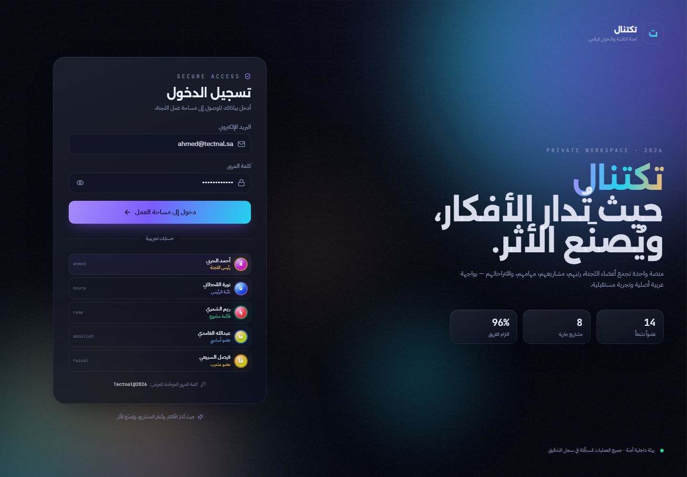

# تكتنال · TECTNAL

> نظام إدارة متكامل للجان التقنية — واجهة عربية RTL بهوية بصرية مستقبلية، ورتب ديناميكية، ومشاريع ومهام واقتراحات وإنجازات في مساحة عمل واحدة.




---

## ١. ما هذا؟

**تكتنال** منصة داخلية جاهزة للاستخدام الفعلي (وليس نموذجاً تجريبياً) لإدارة لجنة تقنية:

| القسم | ما يقدمه |
| --- | --- |
| **مركز القيادة** | ودجات Bento قابلة لإعادة الترتيب، أرقام متحركة، مخططات لحظية، مهام اليوم، نبض الفريق، الصدارة |
| **المشاريع** | عرض شبكة / كانبان / جدول زمني / قائمة، معالم، فريق، ميزانية، مهام مرتبطة، نقاش |
| **الاقتراحات** | تصويت إيجابي/سلبي، نقاط أولوية محسوبة، مسار حالات، تحويل بنقرة إلى مشروع، نقاش متداخل، لوحة مقترحين |
| **المهام** | Kanban بسحب وإفلات، مهام فرعية، تبعيات، مؤقّت وقت، تكرار، تقويم، لوحة "مهامي" |
| **الأعضاء** | بطاقات هولوغرافية، ملف كامل، شارات، هيكل تنظيمي، دعوات بكود |
| **الاجتماعات** | تقويم، جدول أعمال، حضور بأربع حالات، محضر قابل للتحرير |
| **الإنجازات** | صدارة شهرية/سنوية، مستويات، شارات نادرة، احتفال Confetti |
| **مركز المعرفة** | مقالات بمحتوى منسّق، تصنيفات، بحث، مقالات ذات صلة |
| **الملفات** | مجلدات، أنواع، أحجام، معاينة، صلاحيات لكل ملف (نموذج) |
| **التواصل** | إعلانات مثبّتة، قنوات دردشة (إرسال فعلي)، مركز إشعارات |
| **التقارير** | أداء الأعضاء، قمع الاقتراحات، الميزانية، الحضور، تصدير CSV وطباعة |
| **الإعدادات** | مصفوفة صلاحيات كاملة، إنشاء رتب، تغيير رتب الأعضاء، الهوية، سجل التدقيق، منطقة خطر |
| **Command Palette** | `Ctrl/Cmd + K` — بحث موحّد في كل الكيانات + أوامر سريعة |

---

## ٢. حسابات الدخول التجريبية

| الحساب | الرتبة | البريد | كلمة المرور |
| --- | --- | --- | --- |
| أحمد الحربي | رئيس اللجنة (صلاحيات مطلقة) | `ahmed@tectnal.sa` | `Tectnal@2026` |
| نورة القحطاني | نائبة الرئيس | `noura@tectnal.sa` | `Tectnal@2026` |
| خالد العمري | مدير قسم | `khalid@tectnal.sa` | `Tectnal@2026` |
| ريم الشمري | قائدة مشروع | `reem@tectnal.sa` | `Tectnal@2026` |
| عبدالله الغامدي | عضو أساسي | `abdullah@tectnal.sa` | `Tectnal@2026` |
| فيصل السبيعي | عضو متدرب | `faisal@tectnal.sa` | `Tectnal@2026` |

> جرّب الدخول بحساب **فيصل** لترى كيف تختفي أزرار الصفحات والأقسام تلقائياً حسب الصلاحيات.

---

## ٣. التشغيل

```bash
npm install          # تثبيت الحزم
npm run dev          # http://localhost:3000
```

يعمل المشروع فوراً **بدون قاعدة بيانات** عبر طبقة بيانات محلية مُغذّاة ببيانات عربية واقعية (`.data/tectnal.json`).
هذه الطبقة تُحاكي مخطط Prisma نفسه وتُتيح تجربة كل التفاعلات (تصويت، سحب وإفلات، إرسال رسائل، تعديل صلاحيات… مع حفظ دائم بين الجلسات).

```bash
npm run build        # بناء إنتاجي
npm run start        # تشغيل نسخة الإنتاج
npm run typecheck    # فحص TypeScript Strict
npm run fonts        # نسخ الخطوط إلى public/fonts
```

### أوامر قاعدة البيانات (PostgreSQL)

```bash
npm run db:generate  # توليد Prisma Client
npm run db:push      # إنشاء الجداول
npm run db:seed      # تعبئة البيانات العربية (tsx prisma/seed.ts)
npm run db:studio    # Prisma Studio
```

---

## ٤. البنية

```
src/
├─ app/
│  ├─ (workspace)/            # كل صفحات النظام المحمية
│  │  ├─ dashboard/           # مركز القيادة
│  │  ├─ projects/[id]/       # المشاريع + تفاصيل المشروع
│  │  ├─ proposals/ tasks/ members/[id]/
│  │  ├─ meetings/ achievements/ knowledge/[slug]/
│  │  ├─ files/ comms/ reports/ settings/
│  │  ├─ layout.tsx           # AppShell + حماية الجلسة
│  │  └─ loading.tsx          # Skeleton مطابق للمحتوى
│  ├─ sign-in/                # شاشة دخول سينمائية
│  ├─ api/auth/[...nextauth]/ # Auth.js v5
│  ├─ error.tsx not-found.tsx forbidden/
│  ├─ layout.tsx globals.css
├─ components/
│  ├─ ui/                     # Button, Card, Badge, Avatar, Dialog, Tabs…
│  ├─ fx/                     # Aurora, Preloader, Cursor, Spotlight, Reveal, CountUp…
│  ├─ shell/                  # Sidebar (Dock), Topbar, CommandPalette, AppShell
│  ├─ dashboard/ projects/ tasks/ proposals/ members/ meetings/ …
│  └─ providers.tsx           # Session + Query + Theme + i18n + Toaster
├─ hooks/                     # ٢٠ Hook موثّقاً
├─ lib/                       # permissions, types, utils, i18n, navigation, icons
├─ server/
│  ├─ actions.ts              # ٣٠+ Server Action محمي بـ Zod + RBAC + Audit
│  ├─ repository.ts           # طبقة قراءة تُنتج View Models
│  ├─ guard.ts                # requireSession / requirePermission / assertPermission
│  ├─ db.ts                   # مخزن JSON (Demo) مع كتابة متسلسلة
│  └─ data/                   # بيانات عربية واقعية (١٤ عضواً، ٨ مشاريع، ٤٠ مهمة…)
├─ auth.ts                    # NextAuth v5 (Credentials + Discord)
├─ middleware.ts              # خط الدفاع الأول
prisma/
├─ schema.prisma              # ٢٥+ جدولاً، Enums، Indexes، Soft Delete
└─ seed.ts                    # تعبئة PostgreSQL بنفس البيانات
```

---

## ٥. المراحل المسلّمة

| المرحلة | الحالة | أين |
| --- | --- | --- |
| ١ — الهيكل والإعداد | ✅ | `package.json`, `next.config.ts`, `tsconfig.json`, `.env.example` |
| ٢ — Prisma + Seed + الصلاحيات | ✅ | `prisma/schema.prisma`, `prisma/seed.ts`, `src/lib/permissions.ts` |
| ٣ — نظام التصميم + الـ Hooks | ✅ | `src/app/globals.css`, `src/components/ui`, `src/components/fx`, `src/hooks` |
| ٤ — المصادقة + Layout + Palette | ✅ | `src/auth.ts`, `src/middleware.ts`, `src/components/shell` |
| ٥ — لوحة القيادة | ✅ | `src/components/dashboard` |
| ٦ — المشاريع | ✅ | `src/components/projects` |
| ٧ — الاقتراحات | ✅ | `src/components/proposals` |
| ٨ — المهام | ✅ | `src/components/tasks` |
| ٩ — الأعضاء + الاجتماعات + الإنجازات | ✅ | `members/`, `meetings/`, `achievements/` |
| ١٠ — باقي الأقسام + الإشعارات | ✅ | `knowledge/ files/ comms/ reports/ settings/` |
| ١١ — التحسين والنشر | ✅ | دليل النشر أدناه، Typecheck، بناء إنتاجي، Skeletons، Error Boundaries |

---

## ٦. هوية التصميم

**Futuristic Arabic Cyber-Elegance** — خلفية شبه سوداء، أورورا متحركة هادئة، شبكة خافتة، وطبقات Glass مع حدود متدرجة وحبيبات (Noise).

- **الخطوط**: Alexandria (عناوين) + IBM Plex Sans Arabic (نصوص) + JetBrains Mono (أرقام/كود) + Vazirmatn (أرقام عربية) — كلها **مستضافة محلياً** في `public/fonts` مع `font-display: swap` ولا طلب واحد إلى Google.
- **الألوان**: بنفسجي `#7C5CFF` → سماوي `#22D3EE`، تمييز دافئ `#FFB86B`، وألوان دلالية، مع ثيم فاتح كامل عبر `next-themes`.
- **RTL أصيل**: خصائص منطقية (`inset-inline-start`, `padding-inline`) وتخطيط ينعكس تلقائياً.
- **التفاعلات**: Spotlight يتبع المؤشر، Tilt 3D خفيف، Magnetic Buttons، Shimmer، عدّادات، Preloader سينمائي، سحب ودجتس، احترام كامل لـ `prefers-reduced-motion`.

---

## ٧. الرتب والصلاحيات (RBAC)

- ٧ رتب افتراضية: رئيس اللجنة (100) ← نائب (90) ← مدير قسم (70) ← قائد مشروع (55) ← عضو أساسي (40) ← متدرب (20) ← ضيف (10).
- **٤٦ صلاحية دقيقة** بمفاتيح مثل `projects.create`, `tasks.assign`, `members.rank.edit`, `system.danger`.
- مصفوفة صلاحيات تفاعلية في `/settings` مع حفظ فوري وسجل تدقيق لكل تغيير.
- **حماية ثلاثية**: Middleware → فحص على الخادم في كل صفحة وكل Server Action → إخفاء عناصر الواجهة عبر `usePermission` / `hasPermission`.
- الرتب بيانات لا كود: إنشاء رتبة جديدة، تعديل ألوانها ومستواها وصلاحياتها، وترقية/تخفيض الأعضاء — كلها من الواجهة.

---

## ٨. الـ Hooks (٢٠)

جميعها في `src/hooks` ومصدّرة من `@/hooks`.

| Hook | مثال |
| --- | --- |
| `useSpotlight` | `const ref = useSpotlight<HTMLDivElement>(); <div ref={ref} className="spotlight glass" />` |
| `useMagnetic` | `const ref = useMagnetic<HTMLButtonElement>(0.25); <button ref={ref}>ابدأ</button>` |
| `useTilt3D` | `const ref = useTilt3D<HTMLDivElement>(6); <div ref={ref} className="glass" />` |
| `useCountUp` | `const value = useCountUp(1284, { duration: 1400 });` |
| `useScrollProgress` | `const p = useScrollProgress(); style={{ transform: \`scaleX(${p})\` }}` |
| `useCommandPalette` | `const { open, toggle } = useCommandPalette();` |
| `useHotkeys` | `useHotkeys({ "mod+k": toggle, "g d": () => router.push("/dashboard") });` |
| `usePermission` | `const { can } = usePermission(); can("projects.create")` |
| `useOptimisticMutation` | `useOptimisticMutation({ mutationFn: castVote, queryKey: ["proposals"], optimisticUpdate })` |
| `useRealtime` | `useRealtime(() => router.refresh(), { intervalMs: 20000 })` |
| `useInfiniteList` | `const { visible, hasMore, loadMore } = useInfiniteList(items, 12);` |
| `useDebouncedSearch` | `const { query, setQuery, debounced } = useDebouncedSearch(220);` |
| `useLocalDraft` | `const draft = useLocalDraft("proposal-draft", { title: "" });` |
| `useIdleDetector` | `const { idle } = useIdleDetector(60_000);` |
| `useViewTransition` | `const transition = useViewTransition(); transition(() => setView("kanban"));` |
| `useMediaQuery` | `const isDesktop = useMediaQuery("(min-width: 1024px)");` |
| `useClipboard` | `const { copy, copied } = useClipboard(); copy(inviteLink);` |
| `useUndoRedo` | `const { value, set, undo, redo, canUndo } = useUndoRedo(initial);` |
| `useConfetti` | `const { fire } = useConfetti(); fire({ count: 120 });` |
| `useSoundFx` | `const { play, enabled, toggle } = useSoundFx(); play("success");` |
| `useTimeTracker` | `const timer = useTimeTracker(task.id); timer.start(); timer.stop();` |

---

## ٩. الأمان والجودة

- **Zod على كل مُدخل** + رسائل خطأ عربية، و`rate limiting` داخلي لكل إجراء حسّاس.
- كلمات المرور بـ **bcrypt**، جلسات JWT قصيرة (٨ ساعات)، وAuth.js يدير CSRF تلقائياً.
- كل Server Action يبدأ بـ `assertPermission(...)`، ثم يتحقق من صحة البيانات، ثم يسجّل في `AuditLog`.
- حماية XSS: لا `dangerouslySetInnerHTML` إلا لمحتوى مقالات داخلي موثوق.
- **Accessibility**: تسميات `aria`، تركيز مرئي قوي، دعم لوحة المفاتيح للسحب والـ Palette، تباين AA.
- **Error Boundaries** + صفحات 404/403/500 مصممة، وSkeleton Loaders لكل مسار.
- Responsive كامل: جوال (شريط سفلي + Drawer)، تابلت، ديسكتوب (Sidebar عائم قابل للطي).

---

## ١٠. التحول إلى PostgreSQL

طبقة العرض الحالية تعمل على `src/server/db.ts` (JSON) لتشغيل فوري بلا بنية تحتية. للانتقال:

1. أنشئ قاعدة بيانات على **Neon** أو **Supabase** وضع رابطها في `DATABASE_URL`.
2. `npm run db:push` ثم `npm run db:seed`.
3. استبدل دوال القراءة في `src/server/repository.ts` باستعلامات `prisma` (نفس الأشكال المُعادة `ProjectView`, `TaskView`…).
4. استبدل `mutateDb` في `src/server/actions.ts` بـ `prisma.$transaction`.

> مخطط قاعدة البيانات كامل وجاهز (٣٥ جدولاً، Enums، فهارس، حذف ناعم، سجل تدقيق، RBAC، صلاحيات الملفات).

---

## ١١. النشر (Vercel + Neon)

```bash
# 1) قاعدة البيانات
neon projects create tectnal
# انسخ DATABASE_URL إلى Vercel

# 2) الأسرار
npx auth secret                 # AUTH_SECRET
# AUTH_URL=https://your-domain
# AUTH_TRUST_HOST=true

# 3) النشر
vercel --prod
```

- أضف `postinstall: prisma generate` في بيئة الإنتاج.
- أنشئ مجلد `.data` على تخزين دائم، أو انتقل إلى Prisma كما في القسم ١٠.
- Pusher اختياري: أضف المفاتيح، ثم استبدل الاستطلاع في `useRealtime` بقناة `pusher-js`.
- رفع الملفات: وصّل زر الرفع في `/files` بـ UploadThing أو S3 signed URLs.

---

## ١٢. حدود النسخة الحالية (بشفافية)

| العنصر | الحالة |
| --- | --- |
| البيانات | طبقة JSON محلية مُغذّاة، مع مخطط Prisma كامل وSeed جاهز |
| الإشعارات اللحظية | Polling ذكي كل ٤٥ ثانية (جاهز للتبديل إلى Pusher) |
| رفع الملفات | واجهة كاملة + معاينة؛ التخزين الفعلي يحتاج مفاتيح S3/UploadThing |
| الترجمة | العربية كاملة، والإنجليزية لهيكل الواجهة (القوائم، الشريط، الأوامر) — قابل للتوسع عبر `next-intl` |
| البريد | الإعدادات جاهزة؛ إرسال الدعوات فعلياً يحتاج Resend/SMTP |

---

## ١٣. اختبار سريع

1. سجّل الدخول بـ `ahmed@tectnal.sa` (رئيس اللجنة).
2. من **الإعدادات ← الرتب** أزل صلاحية `projects.create` من «قائد مشروع»، ثم سجّل الدخول بـ `reem@tectnal.sa` — سيختفي زر إنشاء مشروع.
3. من **الاقتراحات** صوّت على «مساعد اللجنة الذكي»، ثم حوّل اقتراحاً مقبولاً إلى مشروع.
4. من **المهام** اسحب مهمة بين الأعمدة وشاهد نقاط المسؤول ترتفع عند الإنجاز.
5. من **مركز التواصل** أرسل رسالة في `#general` وتأكد من ثباتها بعد التحديث.
6. اضغط `Ctrl/Cmd + K` وابحث عن «تكتنال».

---

<div align="center">

**تكتنال** — حيث تُدار الأفكار، وتُنجَز المشاريع، ويُصنَع الأثر.

</div>
