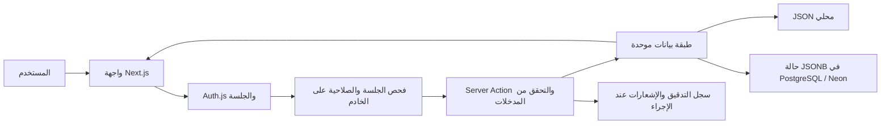

# دليل نظام تكتنال (TECTNAL)

> دليل المستخدم والتشغيل والتطوير — الإصدار `1.1.4`

تكتنال مساحة عمل عربية لإدارة لجنة تقنية واحدة: تجمع الأعضاء والرتب والمشاريع والاقتراحات والمهام والاجتماعات والمعرفة والملفات والتواصل والتقارير في تطبيق ويب أو تطبيق سطح مكتب لنظام Windows.

## فهرس الدليل

1. [نطاق النظام الحالي](#نطاق-النظام-الحالي)
2. [البدء السريع](#البدء-السريع)
3. [إعداد مسؤول النظام لأول مرة](#إعداد-مسؤول-النظام-لأول-مرة)
4. [دليل أقسام النظام](#دليل-أقسام-النظام)
5. [الرتب والصلاحيات](#الرتب-والصلاحيات)
6. [آلية عمل النظام من الداخل](#آلية-عمل-النظام-من-الداخل)
7. [التخزين والنسخ الاحتياطي](#التخزين-والنسخ-الاحتياطي)
8. [تشغيل المطور والبناء](#تشغيل-المطور-والبناء)
9. [النشر على Vercel وNeon](#النشر-على-vercel-وneon)
10. [الأمان والخصوصية](#الأمان-والخصوصية)
11. [استكشاف الأخطاء](#استكشاف-الأخطاء)
12. [الرؤية متعددة اللجان](#الرؤية-متعددة-اللجان)

---

## نطاق النظام الحالي

تشرح هذه الوثيقة ما هو موجود في الشيفرة الحالية، وتفصل ذلك عن التوسّع المخطط لاحقاً.

| الموضوع | الحالة الحالية |
| --- | --- |
| مساحة العمل | لجنة تقنية واحدة باسم «لجنة التقنية والتحول الرقمي» افتراضياً، ويمكن تعديل الاسم من الإعدادات. |
| الحسابات | إعداد أولي لحساب مسؤول واحد، وبعده يمكن إنشاء دعوات للأعضاء وتحديد الرتبة المطلوبة. |
| الرتب | سبع رتب افتراضية وصلاحيات موحّدة على مستوى مساحة العمل. |
| تطبيقات التشغيل | ويب باستخدام Next.js، أو برنامج Windows مبني باستخدام Electron. |
| التخزين المحلي | مستند JSON محلي يحفظ بيانات مساحة العمل. |
| التخزين على Neon | حالة مساحة العمل الحالية تحفظ في JSONB داخل سجل واحد في PostgreSQL؛ مخطط Prisma العلائقي موجود لكنه ليس مسار التخزين المستخدم حالياً لكل كيان. |
| اللجان المنفصلة | عزل الأعضاء والبيانات والصلاحيات بين عدة لجان، ورتبة Chairman عامة مستقلة عن مسؤول النظام: **تصميم مستقبلي ولم يُنفّذ بعد**. |

**تنبيه تشغيلي:** زر الدعوة الحالي ينشئ رمز دعوة مرتبطاً ببريد ورتبة وتنتهي صلاحيته بعد سبعة أيام. لا يرسل النظام رسالة بريد تلقائياً، ولا يحتوي الإصدار الحالي على مسار تسجيل ذاتي كامل لقبول الدعوة وإنشاء الحساب. لذلك أضف الأعضاء وفق آلية الإدارة الموجودة في النسخة، وتحقق من مسار تهيئة حساباتهم قبل الاعتماد التشغيلي الواسع.

## البدء السريع

### تشغيل نسخة الويب محلياً

المتطلبات: Git وNode.js وnpm بإصدارات متوافقة مع Next.js 15، واتصال إنترنت لتنزيل الحزم أول مرة.

```bash
git clone https://github.com/mohmmedalmoni3/SYS.git
cd SYS
npm install
```

أنشئ ملف الإعدادات المحلي من القالب:

```bash
cp .env.example .env
```

على Windows PowerShell:

```powershell
Copy-Item .env.example .env
```

أنشئ قيمة سرية لـ Auth.js وضعها في `AUTH_SECRET` داخل `.env`:

```bash
npx auth secret
```

للتشغيل المحلي على ملف البيانات الافتراضي، اترك:

```dotenv
DATABASE_PROVIDER="json"
AUTH_URL="http://localhost:3000"
NEXT_PUBLIC_APP_URL="http://localhost:3000"
AUTH_TRUST_HOST="true"
```

ثم ابدأ التطبيق:

```bash
npm run dev
```

افتح [http://localhost:3000](http://localhost:3000). يستخدم أمر التطوير المنفذ `3000`.

### استخدام تطبيق Windows

يعمل تطبيق سطح المكتب كبرنامج Electron، ويشغّل خادم Next محلياً على منفذ متاح يختاره تلقائياً. لا يحتاج التطبيق المثبّت إلى Neon أو اتصال قاعدة بيانات خارجي.

1. افتح مُثبّت Windows `TECTNAL-<version>-Setup.exe`.
2. أكمل خطوات التثبيت.
3. شغّل TECTNAL من اختصار سطح المكتب أو قائمة Start.
4. عند أول تشغيل، أنشئ مسؤول النظام الرئيسي.

يُحفظ ملف البيانات ومفتاح جلسات التطبيق في مجلد بيانات المستخدم الذي يديره Electron، وليس ضمن مجلد تثبيت البرنامج. يمكن تثبيت تحديث جديد فوق النسخة الحالية مع بقاء مجلد بيانات المستخدم.

## إعداد مسؤول النظام لأول مرة

عند عدم وجود حسابات، يوجّه التطبيق المستخدم إلى صفحة الإعداد الأولي. أدخل:

1. الاسم الرسمي.
2. البريد الإلكتروني الذي سيُستخدم لتسجيل الدخول.
3. كلمة مرور قوية بطول 12 حرفاً على الأقل.

ينشئ التطبيق حساباً واحداً فقط في هذه المرحلة ويمنحه حالياً رتبة `رئيس اللجنة` التي تحتوي صلاحيات الإدارة الكاملة. بعد نجاح الإنشاء، انتقل إلى صفحة تسجيل الدخول واستخدم البريد وكلمة المرور.

لا توجد بيانات دخول جاهزة أو كلمات مرور افتراضية. احفظ كلمة المرور في مدير كلمات مرور موثوق؛ لا تُحفظ كلمة المرور النصية داخل ملفات النظام.

## دليل أقسام النظام

تظهر الأقسام للمستخدم بحسب صلاحيات رتبته. قد تكون الصفحة موجودة في التطبيق لكنها مخفية أو محمية عن عضو لا يملك صلاحية عرضها.

### مركز القيادة

ملخص لمساحة العمل يضم مؤشرات النشاط والمهام والمشاريع، ومخططات وودجات وروابط سريعة. يستخدمه العضو كبداية للوصول إلى الأعمال اليومية.

### المشاريع

ينظم المشروع وصف العمل وأولويته وحالته وفريقه وتواريخه ومعالمه ومهامه المرتبطة. تتوفر طرق عرض متعددة للمشاريع؛ وتحدد الصلاحيات إمكانية الإنشاء والتعديل والأرشفة ورؤية الميزانية.

الحالات المستخدمة تشمل التخطيط، والنشاط، والتعليق، والاكتمال، والأرشفة. يمكن فتح تفاصيل المشروع لمتابعة مهامه ونقاشه.

### الاقتراحات

تُسجل الأفكار مع وصفها وفئتها وتقدير أثرها وجهدها وتكلفتها. يمكن للأعضاء التصويت إيجاباً أو سلباً، ثم مراجعة الاقتراح وتغيير حالته. يستطيع من يملك صلاحية التحويل نقل الاقتراح المقبول إلى مشروع.

### المهام

تُنشأ المهام مع الوصف والأولوية والموعد والمشروع والمسؤول. تتضمن اللوحة أعمدة سير العمل، وتدعم المهام الفرعية والتبعيات وتسجيل الوقت والتكرار وعرض التقويم و«مهامي» بحسب الإمكانات المتاحة في الواجهة.

حالات المهمة هي: قائمة الانتظار، قيد التنفيذ، المراجعة، والمنجزة، إضافة إلى حالة Backlog الداخلية.

### الأعضاء

يعرض ملفات الأعضاء والرتبة والمهارات والنشاط والإنجازات. يستطيع من يملك صلاحية الدعوة إنشاء رمز دعوة ببريد ورتبة. يستطيع صاحب صلاحية إدارة الرتب تغيير رتبة العضو؛ وتُسجّل تغييرات الرتب في سجل التدقيق.

### الاجتماعات

لجدولة الاجتماعات ومتابعة وقتها وجدول أعمالها. يمكن تسجيل الحضور بإحدى الحالات: حاضر، متأخر، غائب، أو بعذر، وحفظ محضر الاجتماع.

### الإنجازات

يعرض النقاط والمستويات والشارات ولوحات الصدارة والإنجازات المسجلة للأعضاء.

### مركز المعرفة

مقالات ومواد معرفية مع تصنيفات وبحث وروابط لمحتوى ذي صلة. تتحكم الصلاحيات في قراءة المقالات وإنشائها وتعديلها وحذفها.

### الملفات

واجهة لتنظيم الملفات والمجلدات وعرض بيانات الأصول ومعاينتها. **رفع الملفات إلى خدمة تخزين فعلية يحتاج إلى تكامل تخزين خارجي**؛ لا تفترض أن ملفات المستخدم تُحفظ سحابياً بمجرد استخدام هذه الصفحة.

### التواصل

قنوات ورسائل وإعلانات ومركز إشعارات. يعرض النظام الإشعارات داخل الواجهة ويحدّث بيانات مساحة العمل دورياً؛ التحديثات اللحظية تعتمد على الاستطلاع الدوري لا على قناة WebSocket في الإعداد الافتراضي.

### التقارير

ملخصات أداء وحضور وميزانيات ومؤشرات، مع إمكانات تصدير CSV والطباعة بحسب البيانات والصلاحيات المتاحة.

### الإعدادات

إعدادات مساحة العمل والهوية والألوان والثيم، ولوحة الرتب والصلاحيات وسجل التدقيق. بعض الإجراءات الحساسة تتطلب صلاحية النظام الكاملة.

### البحث العام ولوحة الأوامر

استخدم `Ctrl + K` على Windows/Linux أو `⌘ + K` على macOS لفتح لوحة البحث والأوامر، ثم ابحث في العناصر المتاحة أو انتقل بسرعة إلى صفحة.

## الرتب والصلاحيات

يعتمد النظام الحالي على **RBAC**: ينتمي كل حساب إلى رتبة واحدة، وتحمل الرتبة مجموعة مفاتيح صلاحيات. ترتيب الرتب الافتراضي:

| المستوى | الرتبة | وصف عام |
| ---: | --- | --- |
| 100 | رئيس اللجنة | الصلاحيات الكاملة، بما فيها صلاحيات النظام الحساسة. |
| 90 | نائب الرئيس | إدارة واسعة مع استثناء بعض إجراءات النظام الحساسة. |
| 70 | مدير قسم | إشراف أوسع على الأعمال والفرق والتقارير. |
| 55 | قائد مشروع | صلاحيات قيادة المشروع والمهام والنقاشات ذات الصلة. |
| 40 | عضو أساسي | تنفيذ ومشاركة في أعمال مساحة العمل. |
| 20 | عضو متدرب | وصول محدود للتعلم والمشاركة. |
| 10 | ضيف | وصول قراءة محدود. |

تتوزع الصلاحيات على المجموعات التالية: مركز القيادة، المشاريع، الاقتراحات، المهام، الأعضاء، الاجتماعات، الإنجازات، المعرفة، الملفات، التواصل، التقارير، والإعدادات. من أمثلتها `projects.create` و`tasks.assign` و`members.rank.edit` و`system.danger`.

يفحص الخادم الصلاحيات عند فتح الصفحات المحمية وعند تنفيذ الإجراءات. إخفاء زر من الواجهة لتحسين تجربة الاستخدام ليس بديلاً عن التحقق على الخادم.

### إدارة الرتب

1. افتح **الإعدادات ← الرتب والصلاحيات**.
2. اختر رتبة لمراجعة صلاحياتها.
3. فعّل الصلاحيات أو أوقفها ثم احفظ التغييرات.
4. انتقل إلى إدارة الأعضاء لتغيير رتبة عضو، إذا كانت صلاحيتك تسمح.
5. راجع سجل التدقيق للتأكد من توثيق التغيير.

في الإصدار الحالي، إجراءات تعديل الرتب وتغييرها محصورة بمن يملك `system.danger`، أي حساب رئيس اللجنة الافتراضي. الرتب هنا نطاقها مساحة العمل الحالية، وليست رتباً منفصلة لكل لجنة.

## آلية عمل النظام من الداخل

### دورة الطلب



1. يرسل المتصفح طلب صفحة أو إجراء.
2. تتحقق المصادقة من هوية المستخدم.
3. يفحص الخادم صلاحية المستخدم المطلوبة.
4. تتحقق إجراءات الكتابة من المدخلات باستخدام Zod.
5. تقرأ طبقة المستودع البيانات أو تعدّلها عبر طبقة التخزين.
6. تعيد الواجهة عرض البيانات الجديدة، وتُحدّث الصفحات ذات الصلة.

### المصادقة

يستخدم النظام Auth.js v5. طريقة الدخول الأساسية بالبريد وكلمة المرور. تُخزّن كلمة المرور كبصمة باستخدام bcrypt، والجلسة JWT صالحة افتراضياً لمدة ثماني ساعات. يمكن تفعيل Discord اختيارياً بإعداد مفاتيح التطبيق؛ تسجيل Discord مرتبط بحساب موجود مسبقاً وبالبريد المطابق، وليس وسيلة لإنشاء مستخدم مفتوح تلقائياً.

### الإجراءات وسجل التدقيق

تُنفذ عمليات الإنشاء والتعديل والحذف عبر Server Actions. تُفحص المدخلات، وتُطلب الصلاحية المناسبة، وتُسجّل العمليات الإدارية المهمة في Audit Log. تُستخدم حدود محاولات داخل ذاكرة عملية الخادم لبعض الإجراءات الحساسة؛ هذه الحدود ليست مخزناً موزعاً مشتركاً بين كل نسخ الخادم.

## التخزين والنسخ الاحتياطي

### ملف JSON محلياً

في تشغيل الويب المحلي، يستخدم التطبيق افتراضياً:

```text
.data/tectnal.json
```

ينشئ التطبيق حالة فارغة عند أول تشغيل، تشمل الرتب الافتراضية فقط، ولا ينشئ أعضاء أو مشاريع تجريبية تلقائياً. تُسلسل عمليات الكتابة محلياً لتجنب تعارض تحديثات الطلبات داخل العملية الواحدة.

في تطبيق سطح المكتب، توضع البيانات في مجلد مستخدم التطبيق الخاص بنظام التشغيل، خارج مجلد تثبيت TECTNAL. عند أخذ نسخة احتياطية، أوقف التطبيق أولاً، ثم انسخ مجلد بياناته إلى مكان آمن. لا ترفع ملفات البيانات أو `.env` إلى Git.

### Neon / PostgreSQL

لتفعيل Neon، استخدم `DATABASE_PROVIDER=neon` وضع رابط PostgreSQL صالحاً في `DATABASE_URL`. ينشئ التطبيق حالة مساحة العمل في المفتاح `tectnal:application-state` داخل جدول `Setting` بصيغة JSONB، ويستخدم معاملة وقفل سجل أثناء الكتابة.

هذا يعني أن تشغيل Neon حالياً لا يحوّل تلقائياً كل عملية إلى استعلام في جداول `User` و`Project` وغيرها. المخطط العلائقي في `prisma/schema.prisma` جاهز كتصميم بيانات، لكنه منفصل عن طبقة الحالة JSONB التي تستخدمها وظائف التطبيق حالياً.

لنسخة الإنتاج، فعّل النسخ الاحتياطي من مزود PostgreSQL واختبر الاستعادة في بيئة منفصلة. لا تستخدم أمر seed على قاعدة تحتوي بيانات حقيقية.

## تشغيل المطور والبناء

الأوامر الموجودة في `package.json`:

| الأمر | الاستخدام |
| --- | --- |
| `npm run dev` | تشغيل موقع التطوير على `http://localhost:3000`. |
| `npm run build` | إنشاء بناء Next.js للإنتاج. |
| `npm run start` | تشغيل بناء Next.js على المنفذ 3000. |
| `npm run typecheck` | فحص TypeScript دون إصدار ملفات. |
| `npm run desktop:dev` | فتح تطبيق Electron للتطوير. |
| `npm run build:desktop` | بناء التطبيق وإنشاء مُثبّت Windows داخل `release/`. |
| `npm run db:generate` | توليد Prisma Client. |
| `npm run db:push` | مزامنة مخطط Prisma مع PostgreSQL المحدد في `DATABASE_URL`. |
| `npm run db:seed` | تهيئة قاعدة PostgreSQL بمساحة عمل فارغة؛ راجع التحذير أدناه قبل استخدامه. |
| `npm run db:studio` | فتح Prisma Studio. |

**تحذير:** راجع `prisma/seed.ts` قبل تشغيل `db:seed`؛ تهيئة seed موجهة لإعادة تجهيز قاعدة فارغة وقد تمسح بيانات موجودة.

## النشر على Vercel وNeon

### تجهيز Neon

1. أنشئ قاعدة PostgreSQL في Neon.
2. انسخ رابط الاتصال المناسب إلى إعدادات البيئة في Vercel باسم `DATABASE_URL`.
3. أضف المتغيرات التالية في بيئات Vercel المطلوبة:

```dotenv
DATABASE_PROVIDER=neon
DATABASE_URL=<رابط الاتصال الخاص بـ Neon>
AUTH_SECRET=<سر عشوائي قوي>
AUTH_URL=<عنوان التطبيق المنشور>
AUTH_TRUST_HOST=true
NEXT_PUBLIC_APP_URL=<عنوان التطبيق المنشور>
```

4. تحقّق أن `DATABASE_URL` يبدأ من قاعدة Neon الصحيحة قبل تشغيل `npm run db:push`.
5. انشر فرع `main` من Vercel، ثم افتح عنوان الإنتاج وأكمل إعداد مسؤول النظام الأولي.
6. أضف متغيرات البيئة نفسها لكل بيئة تريد تشغيلها. افصل قاعدة الإنتاج عن المعاينة والتطوير.

لا تضع `.env` أو كلمات المرور أو مفاتيح Discord في GitHub أو في ملفات الواجهة العامة. إعداد Discord يحتاج `AUTH_DISCORD_ID` و`AUTH_DISCORD_SECRET` وإعداد رابط callback لدى Discord. خزنها كمتغيرات سرية في Vercel.

## الأمان والخصوصية

- اختَر كلمة مرور مسؤول قوية وفريدة، واحفظها في مدير كلمات مرور.
- استخدم HTTPS في النشر، وسرّاً قوياً وفريداً في `AUTH_SECRET`.
- لا تشارك قاعدة JSON أو نسخة Neon الاحتياطية؛ فهي تتضمن بيانات الحسابات وبصمات كلمات المرور.
- لا ترفع `.env` أو مجلد `.data` إلى المستودع.
- قصر صلاحيات الرتب على ما يحتاجه كل دور، وراجع صلاحيات `system.danger` بعناية.
- صلاحية Middleware تفحص وجود ملف جلسة مبدئياً؛ التحقق الحقيقي من الجلسة والصلاحية يحدث مجدداً في الخادم والـ Server Actions.
- ملفات النظام وصور الواجهة المحلية يمكن توزيعها ضمن تطبيق سطح المكتب. الملفات التي يرفعها المستخدم تحتاج خدمة تخزين خارجية قبل اعتبارها محفوظة سحابياً.
- التطبيق لا يرسل البريد الإلكتروني للدعوات افتراضياً، والتحديثات تظهر عبر استطلاع دوري.

## استكشاف الأخطاء

| العرض | ما الذي تتحقق منه؟ |
| --- | --- |
| لا يفتح موقع التطوير على 3000 | تأكد أن المنفذ غير مستخدم، ثم أوقف العملية التي تشغله أو اختر منفذاً آخر لأمر Next. |
| تظهر صفحة إعداد مسؤول النظام | لا يوجد حساب محفوظ في مخزن البيانات المستخدم حالياً. أكمل الإعداد باسم وبريد وكلمة مرور، ثم سجّل الدخول. |
| يعيدك التطبيق إلى تسجيل الدخول | تحقق من وجود الحساب في مخزن البيانات نفسه ومن استخدام البريد ذاته. في ويب JSON، تأكد أنك تشغل التطبيق من مجلد المشروع نفسه؛ في Electron، استخدم حساب Windows نفسه الذي أنشأ بيانات التطبيق. |
| Neon لا يتصل | تحقق من `DATABASE_PROVIDER=neon`، وصحة `DATABASE_URL`، وإتاحة الاتصال من بيئة Vercel، ثم راجع سجل نشر Vercel. |
| Discord غير ظاهر | يلزم ضبط `AUTH_DISCORD_ID` و`AUTH_DISCORD_SECRET` وإعادة تشغيل/نشر التطبيق. الحساب يجب أن يكون موجوداً مسبقاً ببريد يطابق Discord. |
| فشل تثبيت نسخة جديدة لأن التطبيق مفتوح | مُثبّت Windows ينهي عمليات TECTNAL القديمة قبل الاستبدال. إذا منع Windows الكتابة، أغلق العملية من إدارة المهام ثم أعد المحاولة. |
| لا تحفظ معاينة الملفات ملفاً حقيقياً | ميزة التخزين السحابي تحتاج تكاملاً مع S3 أو خدمة ملفات أخرى؛ الواجهة وحدها لا تنشئ مخزناً خارجياً. |
| تغييرات قاعدة البيانات لا تظهر في Neon | التطبيق يستخدم سجل الحالة `tectnal:application-state` في JSONB؛ لا يكفي النظر إلى جداول الكيانات العلائقية لتوقع ظهور هذه البيانات فيها. |

## الرؤية متعددة اللجان

التوسع الذي طُرح للمستقبل يشمل عدداً من اللجان ضمن نظام واحد، وعضوية ورتب وصلاحيات وبيانات مستقلة لكل لجنة، مع دور Chairman للاطلاع على جميع اللجان، مع بقائه متميزاً عن مسؤول النظام.

هذه الرؤية **ليست ميزة في الإصدار الحالي**. الإصدار الحالي مبني على مساحة عمل لجنة واحدة، ودور `رئيس اللجنة` هو دور الإدارة الكامل نفسه الذي يُمنح لمسؤول النظام الأولي. قبل تشغيل نموذج اللجان المتعددة، يجب تصميم وربط نطاق اللجنة في الحسابات والرتب والمشاريع والمهام والبحث والتقارير والإجراءات والخزن، ثم تحديد مصفوفة الصلاحيات لكل دور واختبار عزل البيانات بين اللجان.

---

## للمساهمين والمطورين

### خريطة المشروع

```text
src/
├── app/             المسارات والصفحات وواجهات الدخول والإعداد
├── components/      واجهات الأقسام ومكونات التصميم
├── hooks/           Hooks للتفاعل والحالة والبحث والصلاحيات
├── lib/             الأنواع والصلاحيات والترجمة والتنقل
├── server/
│   ├── actions.ts   إجراءات الكتابة والتحقق والصلاحية والتدقيق
│   ├── repository.ts قراءات وتجهيز نماذج العرض
│   ├── guard.ts     التحقق من الجلسة والصلاحيات
│   ├── db.ts        مخزن JSON وNeon JSONB
│   └── data/        أنواع البيانات والرتب الأولية
├── auth.ts          إعداد Auth.js
└── middleware.ts    حماية أولية لمسارات مساحة العمل
prisma/
├── schema.prisma   مخطط PostgreSQL العلائقي
└── seed.ts         تجهيز قاعدة بيانات فارغة
electron/            نقطة تشغيل تطبيق Windows
docs/                الأدلة الفنية والمستخدم
```

### عند إضافة ميزة

1. أضف نموذج البيانات أو حقولها في `src/server/data/types.ts` عند الحاجة.
2. أضف القراءة وتحويل البيانات للواجهة في `src/server/repository.ts`.
3. نفذ الكتابة داخل `src/server/actions.ts` مع فحص Zod، و`assertPermission`، والتدقيق والإشعارات عند الحاجة.
4. أضف الصلاحية في `src/lib/permissions.ts`، ثم اربطها بالرتب والواجهة.
5. احمِ صفحة الخادم باستخدام `requireSession` أو `requirePermission`.
6. حدّث هذا الدليل إذا تغيرت طريقة الإعداد أو حدود التخزين.

### ملفات مهمة

| الملف | دوره |
| --- | --- |
| `src/lib/navigation.ts` | اسم التطبيق وأقسام القائمة وإصدار الواجهة. |
| `src/lib/permissions.ts` | قاموس الصلاحيات ومساعدات التحقق. |
| `src/server/data/core.ts` | الرتب الافتراضية وصلاحياتها. |
| `src/server/data/index.ts` | الحالة الأولية الفارغة للإصدار الحالي. |
| `src/server/db.ts` | القراءة والكتابة إلى JSON أو سجل Neon JSONB. |
| `src/server/guard.ts` | حماية الصفحات والإجراءات على الخادم. |
| `src/server/actions.ts` | عمليات النظام القابلة للتغيير. |
| `electron/main.cjs` | نافذة Electron والخادم المحلي وبيانات التطبيق. |
| `scripts/prepare-desktop.mjs` | تجهيز ملفات Next والاعتماديات لتطبيق سطح المكتب. |
| `.env.example` | أسماء متغيرات الإعداد دون أسرار حقيقية. |

